

  <a href="https://osamasharaf.dev">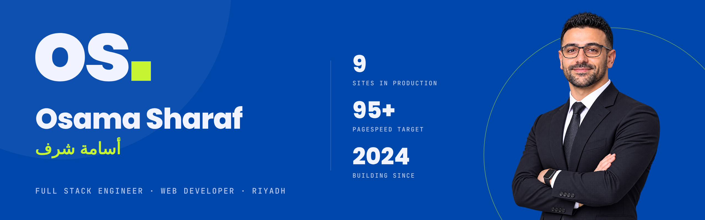</a>

  
  
  
  

## Osama Sharaf (أسامة شرف)

I build websites and web apps end to end: interface design, front end, back end, and deployment. Most of what I ship is bilingual, Arabic and English, for brands in Riyadh.

Full-Stack Engineer at **Digital Codes For Trading**, Riyadh, since June 2026. Freelancing since 2024. BSc in Information Technology, University of Kalamoon, 2025.

**Riyadh, Saudi Arabia** · Arabic and English

### Ask me about

- Scroll-driven storytelling with GSAP, ScrollTrigger and Lenis that still scores well on Core Web Vitals
- Arabic-first (RTL) sites that switch cleanly to English
- Technical SEO and answer-engine visibility: JSON-LD, sitemaps, `llms.txt`
- Shipping fast with Claude Code without losing control of the codebase

### The website experiment

My portfolio is written for people and for AI agents: every page has structured data, and the site publishes plain-text summaries for language models.

  <a href="https://osamasharaf.dev"><code>osamasharaf.dev</code></a> ·
  <a href="https://osamasharaf.dev/llms.txt"><code>/llms.txt</code></a> ·
  <a href="https://osamasharaf.dev/llms-full.txt"><code>/llms-full.txt</code></a> ·
  <a href="https://osamasharaf.dev/robots.txt"><code>/robots.txt</code></a>

### Stack

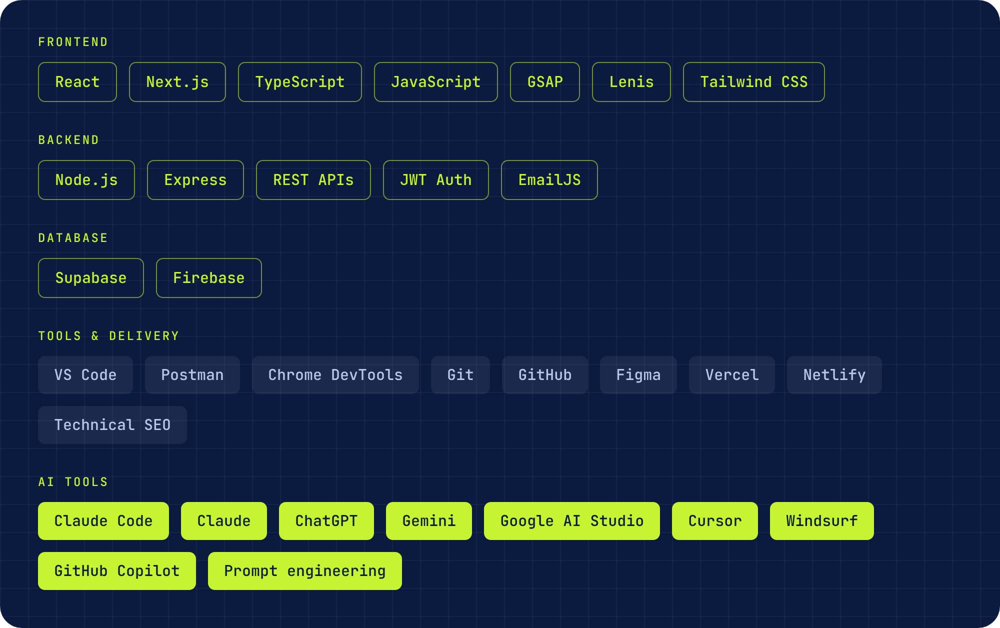

### What I've shipped

| Project | What I built | Stack |
|---|---|---|
| <a href="https://milestone.website">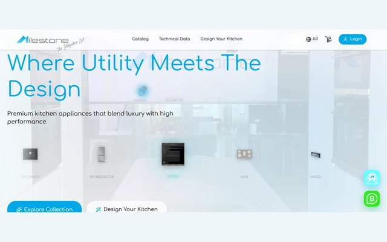</a> **[Milestone Store](https://milestone.website)** | E-commerce platform for a Saudi kitchen-appliance brand: 250+ products, customer accounts, online ordering and an admin dashboard. 95+ PageSpeed, 100 SEO. | `React` `TypeScript` `Node.js` `REST APIs` `Tailwind CSS` |
| <a href="https://milestonechannels.netlify.app">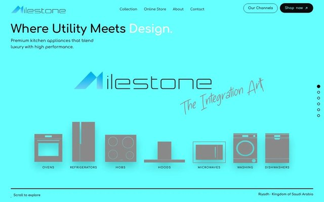</a> **[Milestone Showroom](https://milestonechannels.netlify.app)** · [code](https://github.com/osamasharaf-dev/Brand-Milestone) | One-screen showroom for the same brand. Six scenes swap in place on scroll, no page loads, then hand the visitor to the store. | `JavaScript` `GSAP` `Observer` `Netlify` |
| <a href="https://digital-codes.co">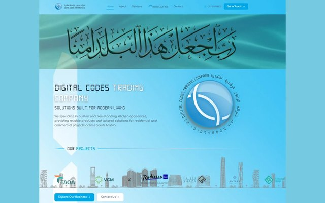</a> **[Digital Codes For Trading](https://digital-codes.co)** | Five-page company website with custom animation and interactive UI. 95+ PageSpeed, 100 SEO. | `React` `TypeScript` `Motion` `Tailwind CSS` |
| <a href="https://noue-chocolate.vercel.app">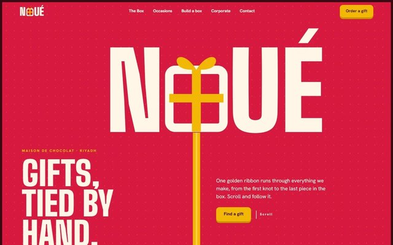</a> **[NOUÉ Chocolate Gifts](https://noue-chocolate.vercel.app)** · [code](https://github.com/osamasharaf-dev/Chocolate) | Scroll-driven site for a chocolate gift house. One ribbon runs from the logo knot to the footer bow; the box unties and 15 pieces animate into view. | `Next.js` `GSAP` `ScrollTrigger` `Lenis` |
| <a href="https://oze-chocolate.vercel.app">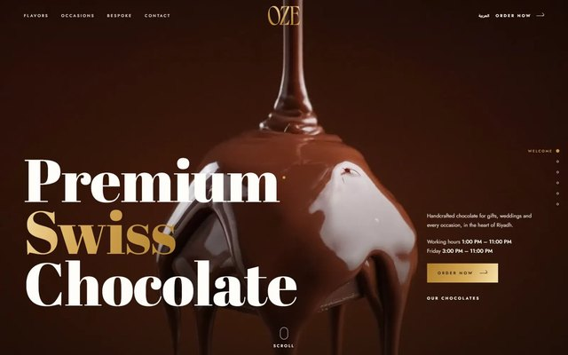</a> **[OZE Chocolate](https://oze-chocolate.vercel.app)** · [code](https://github.com/osamasharaf-dev/Oze-Chocolate) | One-page site for a Swiss chocolate shop in Riyadh, Arabic and English, with flavours, occasions, a map and WhatsApp ordering. | `JavaScript` `GSAP` `MapLibre` `Vercel` |
| <a href="https://ghurza.vercel.app">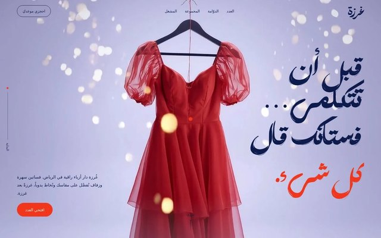</a> **[GHURZA Couture](https://ghurza.vercel.app)** · [code](https://github.com/osamasharaf-dev/gurza-site) | Arabic-first site for a couture house, laid out as a six-chapter fashion magazine with an interactive dress gallery. No framework. | `JavaScript` `GSAP` `ScrollTrigger` `Lenis` |
| <a href="https://gd-graphic-design-company.vercel.app">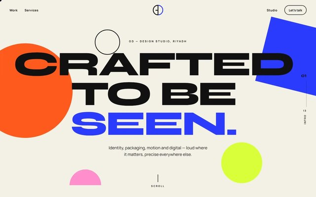</a> **[GD Graphic Design](https://gd-graphic-design-company.vercel.app)** · [code](https://github.com/osamasharaf-dev/GD-GraphicDesignCompany) | One continuous scroll story for a design studio: seven services, seven scenes, each with its own transition. | `Next.js` `TypeScript` `GSAP` `Lenis` |
| <a href="https://azm-builds.vercel.app">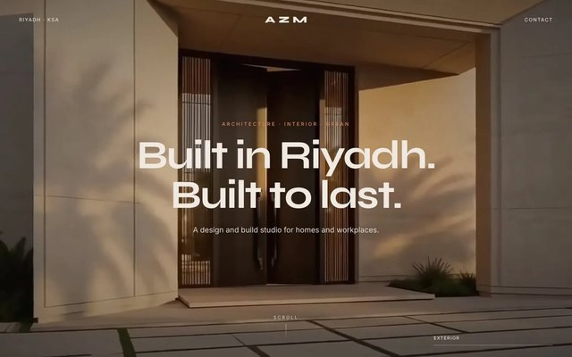</a> **[AZM Studio](https://azm-builds.vercel.app)** · [code](https://github.com/osamasharaf-dev/AZM-STUDIO) | Film-like walk through an architecture studio: street, door, then the house, in five chapters drawn on Canvas 2D. | `JavaScript` `Canvas 2D` `Lenis` `Vercel` |
| <a href="https://reemsharaf.vercel.app">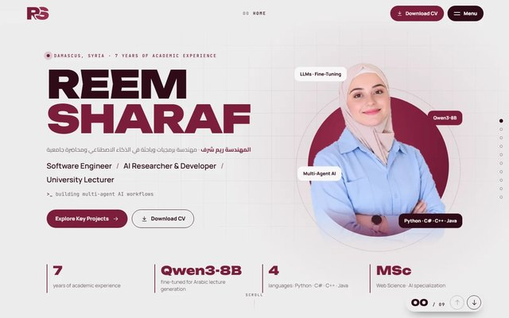</a> **[Reem Sharaf Portfolio](https://reemsharaf.vercel.app)** · [code](https://github.com/osamasharaf-dev/Eng.ReemSharaf) | One-page portfolio for an AI researcher and lecturer: 48 skills, 10 unique section transitions, CV download, zero external libraries. | `JavaScript` `JSON-LD` `Vercel` |

### Contribution activity

<picture>
  <source media="(prefers-color-scheme: dark)" srcset="https://raw.githubusercontent.com/osamasharaf-dev/osamasharaf-dev/output/contributions-dark.svg">
  
</picture>

---

Riyadh · <a href="https://osamasharaf.dev">osamasharaf.dev</a> · <a href="https://wa.me/966508117086">+966 50 811 7086</a>

